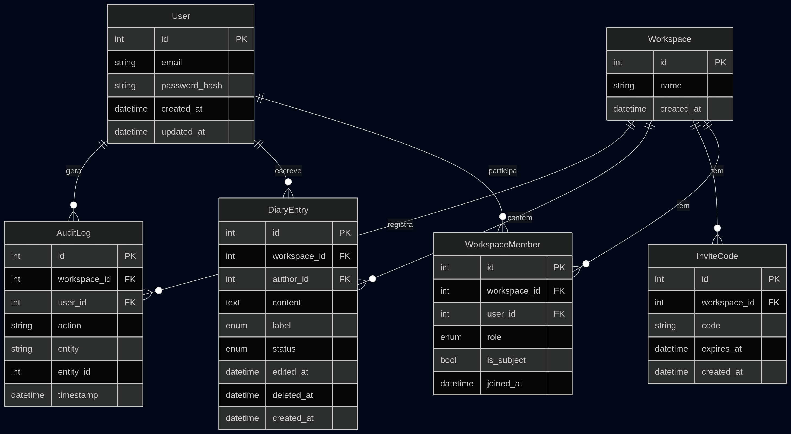
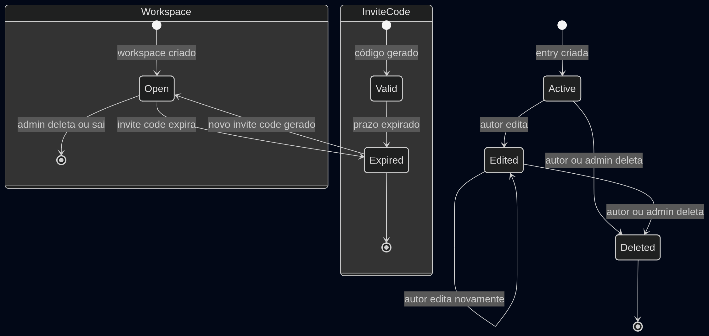
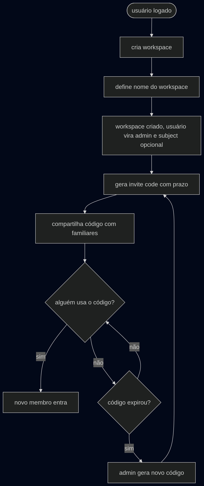
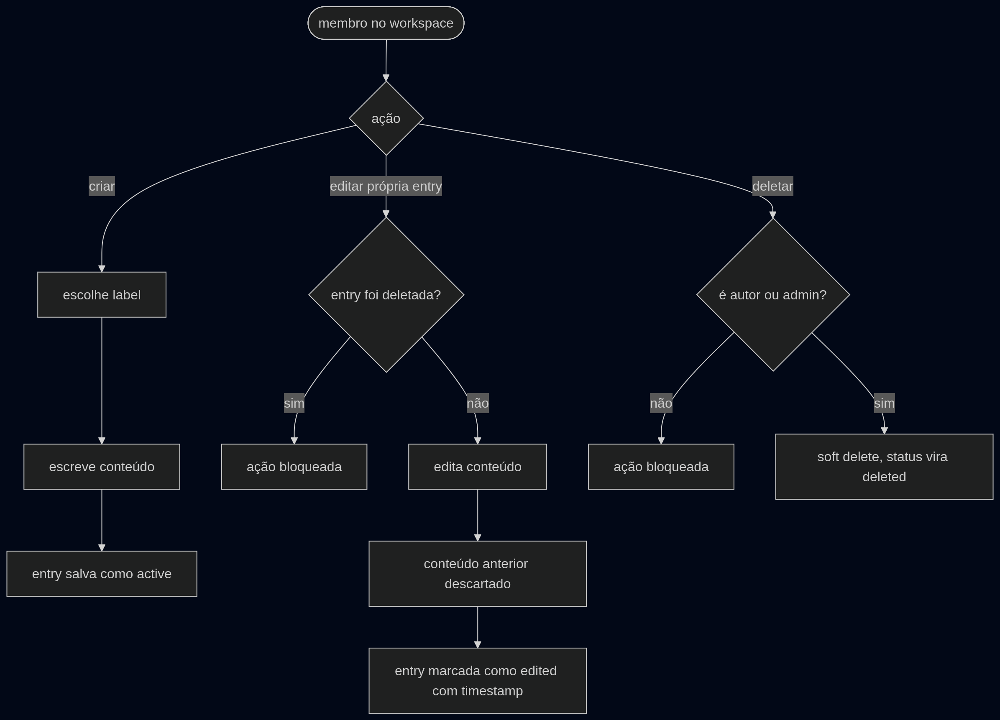

# Elo de Cuidado

## Visão geral
Elo de Cuidado é uma aplicação de diário de saúde compartilhado, voltada primariamente pra famílias que acompanham a saúde de idosos, e, alternativamente para indivíduos que desejam registrar a própria saúde.

A proposta é: um workspace representa um núcleo de cuidado com um sujeito (a pessoa acompanhada) e membros que registram observações ao longo do tempo.

---

## Stack

| Camada         | Tecnologia                    |
| -------------- | ----------------------------- |
| Aplicativo     | React Native + Expo (Android) |
| Backend        | ASP.NET Core (.NET 10)        |
| Banco de dados | MariaDB 11                    |
| ORM            | Entity Framework Core         |
| Autenticação   | JWT HMAC-SHA256 + BCrypt      |
| Infraestrutura | Docker Compose                |

O frontend web (React + Vite) **saiu do escopo do MVP**: a entrega é apenas o
aplicativo Android. A geração de PDF (HU-09) também está fora do MVP, e não há
biblioteca escolhida.

---

## Decisões de arquitetura

### Workspace isolado
Cada workspace é independente. Um usuário que deseja participar de múltiplos contextos (ex: acompanhar um familiar e manter diário próprio) cria workspaces separados com a mesma conta.

### Sujeito identificado por nome, sem acesso automático
O sujeito acompanhado é um campo do workspace (`SubjectName`) e **não recebe
conta nem vínculo automaticamente**. Para participar, ingressa por código de
convite como qualquer outro membro.

A flag `is_subject` existe no modelo, mas **nenhum fluxo a marca como verdadeira
hoje**. Está reservada para quando a HU-11 entrar. Criar conta para alguém sem o
consentimento dessa pessoa contraria a LGPD.

### Exclusão física de entradas (RN-006)
Entradas excluídas são **removidas do banco**, sem estado de excluída e sem
recuperação. O vestígio fica no `AuditLog`, que registra quem removeu, o que foi
removido e quando, **nunca o conteúdo**.

A regra foi redefinida durante o projeto. A modelagem inicial previa exclusão
lógica, com `status = deleted` e `DeletedAt`; manter o conteúdo no banco depois
do pedido de remoção contradiz o direito de eliminação, e os dois campos foram
retirados do modelo.

### Exclusão de conta com autoria anonimizada (RN-011, RN-014)
Ao excluir a conta, os dados pessoais são removidos de forma irreversível, mas
as entradas permanecem no diário dos demais participantes com a autoria
anonimizada: `AuthorId` fica nulo e o aplicativo exibe "Usuário removido".
Apagar o conteúdo junto removeria o histórico de saúde de quem não pediu nada.

A exclusão é recusada quando o titular administra workspace que ainda tem outros
participantes (RN-012), para o espaço não ficar sem administrador.

O token é invalidado no ato: a validação do JWT confere se a conta ainda existe,
além da assinatura. Sem isso a sessão sobreviveria até o token expirar.

### Recuperação de senha
Fora do MVP (HU-10). Não há fluxo implementado.

### Convite por código
Membros entram no workspace via invite code multi-use com prazo de expiração.

---

## Confirmidade com a LGPD

A política completa de retenção, exclusão e anonimização está em
[DATA_LIFECYCLE.md](DATA_LIFECYCLE.md). O sistema implementa os seguintes
mecanismos:

- **Consentimento**: o cadastro exige aceite explícito dos termos (RN-015).
- **Rastreabilidade**: edição e exclusão de entradas geram registro em `AuditLog`
  com responsável, entidade afetada e momento (RN-010). O registro é gravado na
  **mesma transação** da operação: se uma falhar, a outra não acontece, de modo
  que não existe ação sem rastro nem rastro de ação que não ocorreu.
- **Minimização**: o `AuditLog` **não armazena o conteúdo** das entradas. Guardar
  o texto faria a exclusão definitiva deixar de ser definitiva.
- **Direito de eliminação**: a exclusão de conta remove os dados pessoais de
  forma irreversível, encerra a sessão e anonimiza a autoria das entradas que
  permanecem em workspaces de terceiros (RN-011, RN-014).
- **Confidencialidade**: senhas armazenadas apenas como hash BCrypt; todas as
  rotas exigem token válido; nenhum usuário acessa workspace do qual não
  participa (RNF-002, RNF-003).

---

## Modelagem do banco de dados

### Diagrama ER


### Entidades

**User**
Representa uma conta do sistema. Um usuário pode participar de múltiplos workspaces com roles distintas.

**Workspace**
Núcleo de cuidado. Possui um administrador, que é quem o criou (RN-001), e
identifica o sujeito acompanhado por nome (`SubjectName`). Ao ser excluído,
os dados associados são removidos em cascata.

**WorkspaceMember**
Relação entre usuário e workspace. Armazena o papel (`admin` ou `member`) e a
flag `is_subject`, hoje sempre falsa (ver decisões de arquitetura). Um mesmo
usuário participa de múltiplos workspaces com papéis distintos.

**InviteCode**
Código de convite reutilizável associado a um workspace, com validade de até 24
horas (RN-005). Aceito como a pessoa digita: com hífen, espaços ou minúsculas.
Apenas o administrador gera, lista e remove códigos.

**DiaryEntry**
Registro feito por um participante. Possui título, descrição, categoria
(`EntryLabel`) e escala de humor opcional, aplicável apenas à categoria `mood`.
O estado é `active` ou `edited`: **não existe estado de excluída**, pois a
exclusão é física (RN-006). A autoria e o momento são atribuídos pelo servidor e
não são aceitos do cliente, porque a autoria decide quem pode editar depois
(RN-008). Edições substituem o conteúdo anterior sem histórico de versões.

**AuditLog**
Trilha das ações sensíveis (RN-010). Armazena responsável, ação, entidade
afetada e momento, sem o conteúdo. Não há operação de alteração: um registro de
auditoria que pode ser editado não prova nada. O responsável fica nulo quando a
pessoa exerce o direito de eliminação, preservando o que foi feito sem quem fez.

---

## Fluxos do sistema

### Estados



### Cadastro e login


### Criar workspace e convidar membros



### Entrar em workspace via código


### Gerenciamento de entries



### Geração de PDF

> **Fora do MVP.** O diagrama abaixo descreve a HU-09, que não foi implementada
> e não tem biblioteca escolhida. Mantido como registro do desenho original.


---

## Implantação

```
  Aparelho Android                     Máquina do servidor
  ┌────────────────┐                   ┌─────────────────────────────┐
  │  Aplicativo    │                   │   Docker Compose            │
  │  React Native  │    HTTPS          │  ┌───────────────────────┐  │
  │  (APK)         │ ────────────────► │  │ backend  ASP.NET :8080│  │
  └────────────────┘    túnel com      │  └──────────┬────────────┘  │
                        TLS automático │             │               │
                                       │  ┌──────────▼────────────┐  │
                                       │  │ db  MariaDB 11  :3306 │  │
                                       │  └──────────┬────────────┘  │
                                       │             │               │
                                       │  ┌──────────▼────────────┐  │
                                       │  │ backup  a cada 6h     │  │
                                       │  └───────────────────────┘  │
                                       └─────────────────────────────┘
                                                     │
                                            ./backups no host
```

O APK é distribuído pelas **releases do GitHub**, geradas por tag. O endereço da
API é gravado dentro do pacote em tempo de compilação: trocar o endereço exige
gerar um APK novo.

Sem endereço configurado, o aplicativo opera em **modo demonstração**, com os
dados no próprio aparelho e sem depender de servidor. É o que permite demonstrar
o sistema com a infraestrutura fora do ar.

O backend exige HTTPS porque o Android bloqueia tráfego em claro por padrão.
A aplicação se recusa a subir fora de `Development` com a chave de assinatura
de desenvolvimento, que é pública por estar versionada.

---

## Diagrama de classes

O modelo de domínio corresponde ao diagrama ER acima. As entidades são classes
simples de persistência, sem comportamento: a lógica fica nos serviços.

```
Controllers          Services                    Models
───────────          ────────                    ──────
AuthController   ──► IUserService      ────────► User
UserController   ──► ITokenService
WorkspaceController ►IWorkspaceService ────────► Workspace, WorkspaceMember
InviteCodeController►IInviteCodeService────────► InviteCode
DiaryEntryController►IDiaryEntryService────────► DiaryEntry
                        │
                        └──► IAuditLogService ─► AuditLog
```

Cada controller depende apenas de interfaces, resolvidas pelo contêiner de
injeção de dependência. `IDiaryEntryService` depende de `IWorkspaceService` para
a verificação de papel, em vez de repetir a consulta: regra de permissão
duplicada vira duas definições para manter em sincronia.

`IAuditLogService` não tem controller. É injetado nos serviços que executam
ações sensíveis, para o registro nascer junto da operação e na mesma transação.

---

_versão 1.0.0_